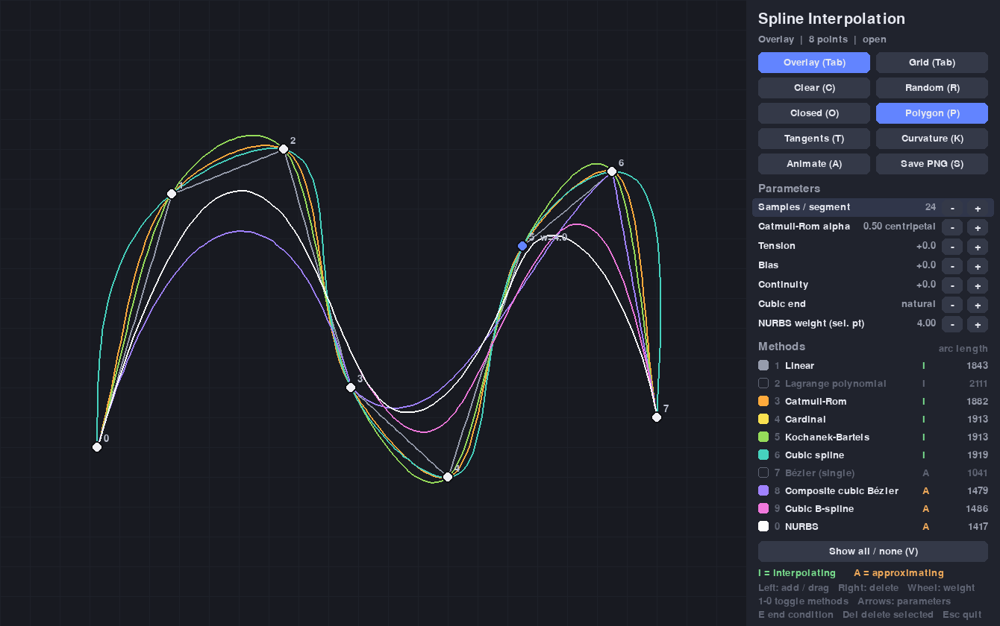
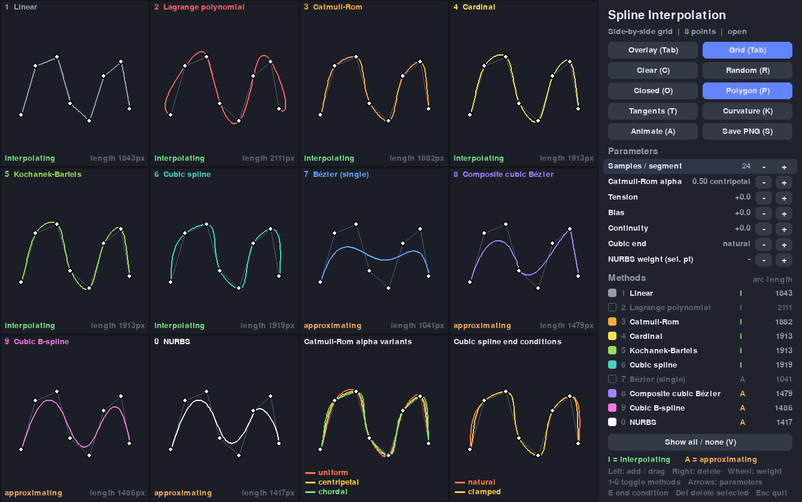
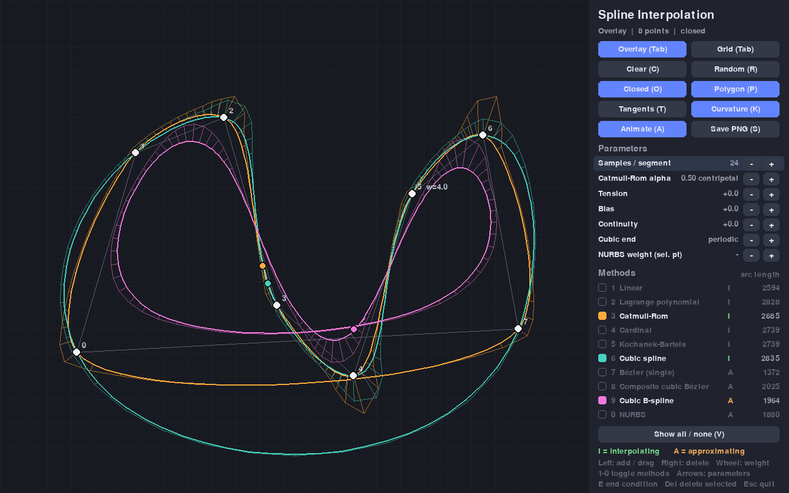
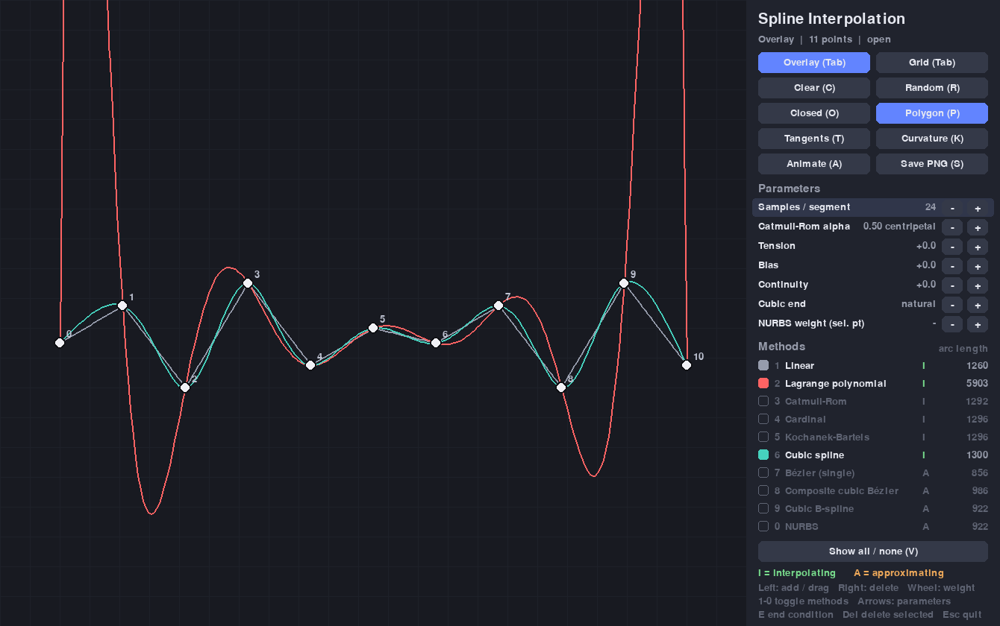

# Spline Interpolation

An interactive comparison of 2D spline interpolation and approximation methods, built with
[Pygame](https://www.pygame.org/) and [NumPy](https://numpy.org/). Place, drag and delete
control points and watch ten curve types react **on the same points** - overlaid in one
view or side by side in a grid.

Every curve is implemented from scratch (no SciPy) as a pure function that takes 2D control
points and returns sampled 2D curve points, completely separate from the rendering code.



## Methods

| # | Method | Interpolating? | Continuity | Local control? | Idea |
|---|--------|:--------------:|:----------:|:--------------:|------|
| 1 | Linear | ✅ yes | C0 | ✅ yes | Straight segments - the control polygon itself. |
| 2 | Lagrange polynomial | ✅ yes | C∞ | ❌ no | One polynomial of degree *n-1* through all points (equally spaced nodes, barycentric form). Shows **Runge's phenomenon**: wild oscillation near the ends with many points. |
| 3 | Catmull-Rom | ✅ yes | C1 | ✅ yes | Cubic Hermite segments whose tangents come from the neighbouring points. `alpha` = 0 / 0.5 / 1 gives the **uniform / centripetal / chordal** variant; centripetal avoids cusps and self-intersections. |
| 4 | Cardinal | ✅ yes | C1 | ✅ yes | Catmull-Rom with tangents scaled by `1 - tension`. Tension 0 = uniform Catmull-Rom, 1 = zero tangents. |
| 5 | Kochanek-Bartels (TCB) | ✅ yes | C1 (C0 if continuity ≠ 0) | ✅ yes | Hermite tangents shaped by **tension**, **bias** (overshoot towards the previous/next segment) and **continuity** (corners). |
| 6 | Cubic spline | ✅ yes | C2 | ❌ no | Global C2 spline, parametric with chord-length knots. End conditions: **natural** (zero curvature) or **clamped** (end tangents along the first/last chord); **periodic** when closed. |
| 7 | Bézier (single) | ❌ no (only ends) | C∞ | ❌ no | One Bézier curve of degree *n-1* using all points as control polygon (de Casteljau). Stays in the convex hull. |
| 8 | Composite cubic Bézier | ❌ no (every 3rd point) | C0 (G1 if handles aligned) | ✅ yes | Points 0, 3, 6, … are anchors on the curve, the two points in between are the handles. Leftover points form a quadratic/linear last piece. |
| 9 | Cubic B-spline | ❌ no (only ends) | C2 | ✅ yes | Uniform cubic B-spline (Cox-de Boor). Open curves use a clamped knot vector, so they start/end at the end points; closed curves are periodic. |
| 0 | NURBS | ❌ no (only ends) | C2 | ✅ yes | Rational cubic B-spline with a **weight per control point**: a larger weight pulls the curve towards that point. Weight 1 everywhere = B-spline. |

**Interpolating** curves pass through every control point; **approximating** curves are
attracted by the control polygon and are usually smoother. The UI marks them with **I**
(green) and **A** (orange).

### Side-by-side grid



The grid shows all ten methods with the same points, plus two comparison cells:
**Catmull-Rom alpha variants** (uniform vs. centripetal vs. chordal) and **cubic spline end
conditions** (natural vs. clamped). You can add, drag and delete points in any cell.

### Closed curves, curvature comb and animation



The **curvature comb** draws the normal scaled by the curvature at every sample - jumps in the
comb reveal where a curve is only C1 (Catmull-Rom) instead of C2 (cubic spline, B-spline).
The **animation** moves a point along every curve at constant arc-length speed, with its
tangent.

### Runge's phenomenon



With 11 points the global Lagrange polynomial (red) already overshoots massively near the
ends, while the cubic spline (teal) stays calm.

## Features

- Ten curve methods with live parameters: samples per segment, Catmull-Rom `alpha`,
  tension, bias, continuity, cubic end condition and the NURBS weight of the selected point.
- **Overlay mode** with a colour legend (click to toggle methods) showing the **arc length**
  of every curve, and a **side-by-side grid mode**.
- Open / closed curves for every method.
- Optional control polygon, tangent ticks, curvature comb and animated point.
- Random point sets, clear, save PNG.

## Installation

Requires Python 3.10+.

```bash
git clone https://github.com/CommanderVibeCody/spline-interpolation.git
cd spline-interpolation
python -m venv .venv
source .venv/bin/activate        # Windows: .venv\Scripts\activate
pip install -r requirements.txt
```

## Running

```bash
python main.py
```

## Controls

| Input | Action |
|-------|--------|
| Left click (empty space) | Add a control point (appended at the end) |
| Left drag on a point | Move it (works in overlay and in every grid cell) |
| Right click on a point | Delete it |
| Mouse wheel on a point | Change its NURBS weight (×1.25 / ×0.8) |
| Mouse wheel on a parameter | Change that parameter |
| Click a method in the legend | Show / hide it in the overlay |
| `1` – `9`, `0` | Show / hide method 1 – 10 |
| `V` | Show all / hide all methods |
| `Tab` / `G` | Toggle overlay / grid view |
| `O` | Toggle open / closed curves |
| `C` | Clear all points |
| `R` | Random points |
| `P` | Toggle control polygon |
| `T` | Toggle tangent ticks |
| `K` | Toggle curvature comb |
| `A` | Toggle animated point |
| `E` | Cycle cubic spline end condition (natural / clamped) |
| `↑` / `↓` | Select a parameter in the side panel |
| `←` / `→` (or `-` / `+`) | Decrease / increase it (`Shift` = bigger steps) |
| `[` / `]` | Decrease / increase the weight of the selected point |
| `Delete` / `Backspace` | Delete the selected point |
| `Home` | Reset parameters and weights |
| `S` | Save a PNG of the window to `screenshots/` |
| `Esc` | Quit |

## Project structure

```
spline-interpolation/
├── main.py                     # entry point
├── spline_interp/
│   ├── app.py                  # Pygame app: events, overlay/grid views, side panel
│   ├── rendering.py            # drawing curves, points, tangents, curvature combs
│   ├── ui.py                   # colours, fonts, buttons, text helpers
│   ├── params.py               # tunable parameters and their ranges
│   └── splines/                # pure curve functions (NumPy only, no Pygame)
│       ├── __init__.py         # method registry (interpolating?, continuity, local control)
│       ├── common.py           # input normalisation, duplicates, 0/1/2-point cases
│       ├── linear.py
│       ├── lagrange.py
│       ├── hermite.py          # Catmull-Rom, Cardinal, Kochanek-Bartels
│       ├── cubic.py            # natural / clamped / periodic cubic spline
│       ├── bezier.py           # single Bézier, composite cubic Bézier
│       ├── bspline.py          # uniform cubic B-spline, NURBS (Cox-de Boor)
│       └── analysis.py         # arc length, tangents, curvature
├── tests/                      # pytest suite (curves, analysis, headless UI smoke tests)
├── tools/make_screenshot.py    # regenerates the screenshots in docs/ headlessly
└── docs/                       # screenshots
```

Using the curve functions directly:

```python
from spline_interp.splines import catmull_rom, nurbs

points = [(0, 0), (100, 80), (200, -20), (300, 60)]
curve = catmull_rom(points, closed=False, samples=32, alpha=0.5)   # (m, 2) array
heavy = nurbs(points, weights=[1, 5, 1, 1])
```

## Tests

```bash
pip install -r requirements-dev.txt
python -m pytest
```

The suite checks that interpolating curves pass through every point, the end point and
end tangent properties of Bézier and B-spline curves, the convex hull property, partition of
unity of the B-spline basis, local control, that collinear points give a straight line, that
closed curves close, determinism, edge cases (0, 1, 2 points and duplicates) and runs the
Pygame app headlessly (`SDL_VIDEODRIVER=dummy`): main loop, adding/dragging/deleting points
with the mouse, every key and every button.

Regenerate the screenshots with `python tools/make_screenshot.py`.

## License

[MIT](LICENSE)
